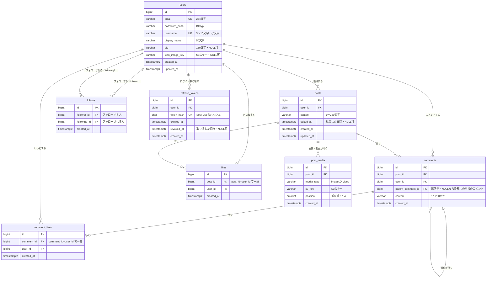

# データベース設計書：RaiseTechtimeline

| 項目 | 内容 |
|---|---|
| 版 | 0.4 |
| 作成日 | 2026-11-08 |
| 状態 | たたき台（ユーザーの確認待ち） |
| データベース | PostgreSQL 18 |

---

## 1. 共通の決まり

| 項目 | 決まり |
|---|---|
| テーブル名・列名 | 英小文字とアンダーバー（`snake_case`）。テーブル名は複数形 |
| ID | `bigint` の自動の連番（`GENERATED ALWAYS AS IDENTITY`） |
| 日時 | `timestamptz`（時差の情報つき）。UTC で保存し、画面で日本時間にして表示する |
| 文字列 | `varchar(n)`。PostgreSQL の `varchar(280)` は「文字」で数えるので、絵文字も1文字（[post.md](features/post.md) 3.1 と同じ数え方） |
| 消したときの動き | 親を消したら子も消す（`ON DELETE CASCADE`）。5章 |
| テーブルの変更 | Flyway の SQL ファイルを足して行う |

---

## 2. ER 図

---

## 3. テーブルの定義

### 3.1 `users`（ユーザー）

| 列 | 型 | NULL | 説明 |
|---|---|---|---|
| id | bigint | × | 主キー |
| email | varchar(254) | × | メールアドレス。小文字にそろえて保存。**一意** |
| password_hash | varchar(255) | × | パスワードを BCrypt でハッシュ化したもの |
| username | varchar(15) | × | ユーザー名（`@` は付けない）。小文字にそろえて保存。**一意**。半角英数字と `_` だけ（CHECK 制約） |
| display_name | varchar(50) | × | 表示名 |
| bio | varchar(160) | ○ | 自己紹介 |
| icon_image_key | varchar(255) | ○ | アイコン画像の S3 のキー。NULL なら初期のアイコン |
| created_at | timestamptz | × | 登録した日時 |
| updated_at | timestamptz | × | 最後に変えた日時 |

### 3.2 `posts`（投稿）

| 列 | 型 | NULL | 説明 |
|---|---|---|---|
| id | bigint | × | 主キー |
| user_id | bigint | × | 投稿した人（`users.id`） |
| content | varchar(280) | × | 本文。1文字以上（CHECK 制約） |
| edited_at | timestamptz | ○ | 編集した日時。NULL なら編集していない（「編集済み」の表示に使う） |
| created_at | timestamptz | × | 投稿した日時（タイムラインの並び順） |
| updated_at | timestamptz | × | 最後に変えた日時 |

画像・動画は、1つの投稿に複数付くので、別のテーブル（3.2.1）に入れる。

### 3.2.1 `post_media`（投稿の画像・動画）

| 列 | 型 | NULL | 説明 |
|---|---|---|---|
| id | bigint | × | 主キー |
| post_id | bigint | × | 付いている投稿（`posts.id`） |
| media_type | varchar(10) | × | `image`（画像）か `video`（動画）。この2つだけ（CHECK 制約） |
| s3_key | varchar(255) | × | S3 のキー。**一意** |
| position | smallint | × | 並び順。1〜4（CHECK 制約） |
| created_at | timestamptz | × | 保存した日時 |

- **`(post_id, position)` で一意**：同じ投稿に同じ並び順は2つない。position が1〜4なので、1つの投稿に**4つまで**しか入らない
- 「動画は1本だけ」「画像と動画を混ぜない」は、1つの行だけでは確かめられないので、**サーバーで**確かめる（保存の前に、その投稿の行をまとめて見る）

### 3.3 `comments`（コメント）

| 列 | 型 | NULL | 説明 |
|---|---|---|---|
| id | bigint | × | 主キー |
| post_id | bigint | × | コメントした投稿（`posts.id`） |
| user_id | bigint | × | コメントした人（`users.id`） |
| parent_comment_id | bigint | ○ | 返信先のコメント（`comments.id`）。NULL なら投稿への直接のコメント |
| content | varchar(280) | × | 本文。1文字以上 |
| created_at | timestamptz | × | コメントした日時 |

- コメントは編集しないので `updated_at` は持たない
- 返信も同じテーブルに入れ、`parent_comment_id` で返信先を指す（自分のテーブルを指すつながり）。返信の返信なら、返信先は「返信」の行になる
- 返信先は**同じ投稿のコメント**であること（サーバーで確かめる）
- 画面で1段にまとめて表示するため、各返信が「どの一番上のコメントの下に並ぶか」は、返信先をたどって求める（件数が増えて遅くなったら、一番上のコメントの ID を列に持つことを考える）

### 3.3.1 `comment_likes`（コメントへのいいね）

| 列 | 型 | NULL | 説明 |
|---|---|---|---|
| id | bigint | × | 主キー |
| comment_id | bigint | × | いいねしたコメント・返信（`comments.id`） |
| user_id | bigint | × | いいねした人（`users.id`） |
| created_at | timestamptz | × | いいねした日時 |

- **`(comment_id, user_id)` で一意**：同じ人が同じコメントに2回いいねできない
- 投稿のいいね（`likes`）と分けたのは、1つのテーブルで「投稿か、コメントか」を見分ける列を持つと、外部キー（つながりの決まり）を DB で守れなくなるため

### 3.4 `likes`（いいね）

| 列 | 型 | NULL | 説明 |
|---|---|---|---|
| id | bigint | × | 主キー |
| post_id | bigint | × | いいねした投稿（`posts.id`） |
| user_id | bigint | × | いいねした人（`users.id`） |
| created_at | timestamptz | × | いいねした日時（いいねした人の一覧の並び順） |

- **`(post_id, user_id)` で一意**：同じ人が同じ投稿に2回いいねできない（[like.md](features/like.md) 3）

### 3.5 `follows`（フォロー）

| 列 | 型 | NULL | 説明 |
|---|---|---|---|
| id | bigint | × | 主キー |
| follower_id | bigint | × | フォロー**する**人（`users.id`） |
| following_id | bigint | × | フォロー**される**人（`users.id`） |
| created_at | timestamptz | × | フォローした日時（一覧の並び順） |

- **`(follower_id, following_id)` で一意**：同じ人を2回フォローできない
- **`follower_id <> following_id`**（CHECK 制約）：自分自身はフォローできない
- 例：太郎（id=1）が花子（id=2）をフォロー → `follower_id=1, following_id=2`。花子がフォローバック → `follower_id=2, following_id=1` の行が増える

### 3.6 `refresh_tokens`（リフレッシュトークン）

ログインを続けるための「引換券」（[authentication.md](features/authentication.md) 7章）。ログイン・更新のたびに1行増える。

| 列 | 型 | NULL | 説明 |
|---|---|---|---|
| id | bigint | × | 主キー |
| user_id | bigint | × | 持ち主（`users.id`）。ユーザーを消したら一緒に消える |
| token_hash | char(64) | × | トークンの SHA-256 のハッシュ（16進数64文字）。**一意**。トークンそのものは保存しない（DB が漏れても使えない） |
| expires_at | timestamptz | × | 期限（発行から7日） |
| revoked_at | timestamptz | ○ | 使えなくした日時（取り替え・ログアウト・使い回しの検知）。NULL なら有効 |
| created_at | timestamptz | × | 発行した日時 |

- 有効なのは「`revoked_at` が NULL で、`expires_at` が今より後」の行だけ
- `revoked_at` が入った行が使われたら、使い回し（盗まれた）とみなして、その人の行をすべて取り消す
- 期限の切れた行は、1日1回まとめて消す。取り消した行も期限までは残す（使い回しを見つけるため）

---

## 4. 索引（さくいん。探すのを速くするための目次）

| テーブル | 列 | 使う場面 |
|---|---|---|
| users | `email`（一意） | ログイン |
| users | `username`（一意） | プロフィールの URL・検索 |
| posts | `created_at DESC, id DESC` | 「すべて」タブ |
| posts | `user_id, created_at DESC, id DESC` | 「フォロー中」タブ・プロフィールの投稿 |
| post_media | `(post_id, position)`（一意） | 投稿の画像・動画を並び順で出す |
| comments | `post_id, created_at` | 投稿のコメント一覧・コメント数 |
| comments | `parent_comment_id` | 返信の一覧・返信数 |
| comment_likes | `(comment_id, user_id)`（一意） | コメントのいいね数・自分がいいねしたか |
| comment_likes | `user_id` | ユーザーを消したとき |
| likes | `(post_id, user_id)`（一意） | いいね数・自分がいいねしたか |
| likes | `user_id` | ユーザーを消したとき |
| follows | `(follower_id, following_id)`（一意） | フォロー中か・フォロー数・「フォロー中」タブ |
| follows | `following_id` | フォロワー数・フォロワーの一覧 |
| refresh_tokens | `token_hash`（一意） | 更新・ログアウトのときにトークンを探す |
| refresh_tokens | `user_id` | 使い回しを見つけたとき、その人のトークンをまとめて取り消す |
| refresh_tokens | `expires_at` | 期限切れをまとめて消す（1日1回） |

- ユーザー検索の部分一致（`LIKE '%言葉%'`）は、ふつうの索引では速くならない。ユーザーが増えたら、PostgreSQL の `pg_trgm`（部分一致を速くする仕組み）を足す。今は使わない
- コメント数・いいね数・フォロー数は、別の列に数を持たず、毎回数える（数がずれる心配がなく、作りが簡単。今の規模なら十分速い）

---

## 5. 消したときの動き

| 消すもの | 一緒に消えるもの |
|---|---|
| 投稿 | その投稿の画像・動画の行（`post_media`）・コメント・返信・いいね・コメントへのいいね（`ON DELETE CASCADE`）。S3 のファイルはアプリが消す |
| コメント | その下の返信（返信の返信も）と、それらへのいいね（`parent_comment_id` の `ON DELETE CASCADE`） |
| ユーザー（退会。今回は作らない） | その人の投稿・コメント・いいね・フォロー（する・される両方）・リフレッシュトークン |

---

## 6. 画像・動画の保存

| 項目 | 決まり |
|---|---|
| 保存先 | S3（[infrastructure.md](infrastructure.md)）。DB にはキーだけ |
| キーの形 | 投稿の画像・動画：`posts/{年}/{月}/{ランダムな文字列}.{拡張子}`、アイコン：`icons/{ランダムな文字列}.{拡張子}`、送信中の動画の一時置き場：`tmp/{ランダムな文字列}.mp4`（1日で自動で消える） |
| 表示 | サーバーが期限付きの URL（署名付き URL）を作って画面に渡す |
| 差し替え・削除 | 前のファイルは S3 からも消す |

---

## 7. 要件との対応

| 要件 | テーブル・列 |
|---|---|
| 投稿・コメントは280文字まで | `posts.content`・`comments.content`（varchar(280)） |
| 画像は4枚まで、または動画1本・S3 に保存 | `post_media`（position 1〜4。動画1本・混ぜないはサーバーで確かめる） |
| 編集済みの表示 | `posts.edited_at` |
| いいねは1人1回 | `likes`・`comment_likes` の一意制約 |
| コメントへの返信（何段でも） | `comments.parent_comment_id` |
| 自分はフォローできない・2回フォローできない | `follows` の CHECK 制約・一意制約 |
| フォローバックの判定 | `follows` で逆向きの行があるか |
| 「フォロー中」タブ | `follows.follower_id = 自分` の `following_id` と自分の投稿 |
| ログインを7日続ける・ログアウトで止める | `refresh_tokens`（ハッシュ・期限・取り消し） |
| メールアドレス・ユーザー名は大文字・小文字を区別しない | `users` に小文字で保存（CHECK 制約）＋一意制約 |

---

## 8. この文書で新しく決めたこと（確認をお願いします）

- 「編集済み」は `edited_at` 列で判定する
- コメント数・いいね数・フォロー数は列に持たず、毎回数える
- ユーザー検索を速くする仕組み（`pg_trgm`）は、今は入れない
- 返信はコメントと同じテーブルに入れ、`parent_comment_id` で返信先を指す
- コメントへのいいねは、投稿のいいねと別のテーブル（`comment_likes`）にする
- 投稿の画像・動画は `post_media` テーブルに分ける（`posts.image_key` はなくした）
- リフレッシュトークンの `refresh_tokens` テーブルを足す（ハッシュだけ保存）
- テーブルは機能を作るときに Flyway で足していく。今あるのは `users`（V1）・`refresh_tokens`（V2）・`posts`（V3）・`follows`（V4）。`post_media` は画像・動画の機能のときに足す
- `follows` は、フォローの画面より先に、投稿と一緒に作った（「フォロー中」タブの SQL を最終の形にするため）
- `posts` の索引には `id DESC` も入れた（同じ時刻の投稿を ID の大きい順に並べ、続きの読み込みで抜けも重なりも出さないため）

## 9. 改訂履歴

| 版 | 日付 | 内容 |
|---|---|---|
| 0.1 | 2026-11-08 | たたき台を作成 |
| 0.2 | 2026-11-08 | コメントへの返信（`comments.parent_comment_id`）とコメントへのいいね（`comment_likes`）を追加。画像4枚・動画1本に合わせ、`posts.image_key` を `post_media` テーブルに置き換え |
| 0.3 | 2026-11-08 | ログインの実装に合わせて `refresh_tokens` テーブル（3.6）を追加。`users` に小文字の CHECK 制約 |
| 0.4 | 2026-11-08 | 投稿の実装に合わせて `posts`（V3）・`follows`（V4）を作った（8章）。`post_media` は画像・動画の機能のとき |
