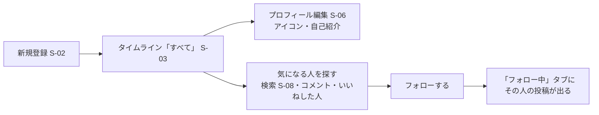

# 機能一覧：RaiseTechtimeline

| 項目 | 内容 |
|---|---|
| 版 | 0.6 |
| 作成日 | 2026-11-08 |
| 状態 | たたき台（ユーザーの確認待ち） |

機能ごとの細かい決まり（入力のルール・処理の流れ・エラー）は、`features/` の機能定義書に書く。

---

## 1. 機能一覧

「ログイン」欄：○ = ログインしないと使えない。— = ログインしていなくても使える。

### 1.1 認証（[authentication.md](features/authentication.md)）

| ID | 機能 | 内容 | ログイン | 画面 |
|---|---|---|---|---|
| A-01 | 新規登録 | メールアドレス・パスワード・ユーザー名・表示名で登録する。登録したらログインした状態でタイムラインへ | — | S-02 |
| A-02 | ログイン | メールアドレスとパスワードでログインする | — | S-01 |
| A-03 | ログアウト | ログアウトしてログイン画面へ戻る | ○ | 全画面のメニュー |
| A-04 | ログインしていない人の扱い | 新規登録・ログイン以外の画面を開いたら、ログイン画面へ移す。API も断る | — | — |

### 1.2 タイムライン（[timeline.md](features/timeline.md)）

| ID | 機能 | 内容 | ログイン | 画面 |
|---|---|---|---|---|
| TL-01 | 「すべて」タブ | フォローしていない人も含め、全員の投稿を新しい順に表示する | ○ | S-03 |
| TL-02 | 「フォロー中」タブ | 自分とフォローしている人の投稿だけを新しい順に表示する | ○ | S-03 |
| TL-03 | 続きの読み込み | 20件ずつ。下までスクロールしたら続きを読み込む | ○ | S-03 |
| TL-04 | 投稿の表示内容 | アイコン・表示名・@ユーザー名・投稿日時・本文・画像・動画・コメント数・いいね数・自分がいいねしたか | ○ | S-03・S-05 |

### 1.3 投稿（[post.md](features/post.md)）

| ID | 機能 | 内容 | ログイン | 画面 |
|---|---|---|---|---|
| P-01 | 投稿する | 本文（1〜280文字）に、画像4枚まで、または動画1本（なくてもよい）を付けて投稿する | ○ | S-03・M-01 |
| P-02 | 投稿の詳細 | 1つの投稿と、そのコメントの一覧を表示する | ○ | S-04 |
| P-03 | 投稿の編集 | 自分の投稿の本文と画像・動画を変える。編集した投稿には「編集済み」と出す | ○ | M-01 |
| P-04 | 投稿の削除 | 確認のうえ、自分の投稿を消す。コメント・いいね・画像・動画も一緒に消す | ○ | S-03・S-04・S-05 |

### 1.4 コメント（[comment.md](features/comment.md)）

| ID | 機能 | 内容 | ログイン | 画面 |
|---|---|---|---|---|
| C-01 | コメントする | 投稿（他の人の投稿も）に、1〜280文字のコメントを付ける | ○ | S-04 |
| C-02 | コメントの一覧 | 投稿の詳細に、コメントを古い順に表示する。返信はコメントの下に字下げして出す。コメントした人の横にフォローボタンを出す | ○ | S-04 |
| C-03 | コメント数・返信数 | 投稿ごとのコメント数と、コメントごとの返信数を表示する | ○ | S-03・S-04・S-05 |
| C-04 | コメントの削除 | 確認のうえ、自分のコメントを消す。その下の返信も一緒に消える | ○ | S-04 |
| C-05 | コメントへの返信 | コメント・返信に、1〜280文字で返信する（X と同じく何段でもできる） | ○ | S-04 |

### 1.5 いいね（[like.md](features/like.md)）

| ID | 機能 | 内容 | ログイン | 画面 |
|---|---|---|---|---|
| L-01 | いいね・取り消し | ハートを押すといいね、もう一度押すと取り消し。1つの投稿に1人1回まで。自分の投稿にもできる | ○ | S-03・S-04・S-05 |
| L-02 | いいね数 | 投稿ごとのいいね数を表示する | ○ | S-03・S-04・S-05 |
| L-03 | いいねした人の一覧 | いいね数を押すと、いいねした人の一覧を出す。それぞれの横にフォローボタンを出す | ○ | M-02 |
| L-04 | コメントへのいいね | コメント・返信にも、投稿と同じようにいいね・取り消し・数・一覧がある | ○ | S-04・M-02 |

### 1.6 プロフィール（[profile.md](features/profile.md)）

| ID | 機能 | 内容 | ログイン | 画面 |
|---|---|---|---|---|
| PF-01 | プロフィールの表示 | アイコン・表示名・@ユーザー名・自己紹介・登録した月・フォロー数・フォロワー数と、その人の投稿の一覧 | ○ | S-05 |
| PF-02 | プロフィールの編集 | 自分の表示名・自己紹介・アイコン画像を変える | ○ | S-06 |

### 1.7 フォロー（[profile.md](features/profile.md)）

| ID | 機能 | 内容 | ログイン | 画面 |
|---|---|---|---|---|
| FL-01 | フォロー・フォロー解除 | 他のユーザーをフォローする・やめる。自分はフォローできない | ○ | S-04・S-05・S-07・S-08・M-02 |
| FL-02 | フォローバック | 自分をフォローしている人には「フォローされています」と出し、ボタンを「フォローバック」にする | ○ | 同上 |
| FL-03 | フォロー数・フォロワー数 | プロフィールに表示する | ○ | S-05 |
| FL-04 | フォロー・フォロワーの一覧 | フォロー数・フォロワー数を押すと、その一覧を出す | ○ | S-07 |

### 1.8 ユーザー検索（[user-search.md](features/user-search.md)）

| ID | 機能 | 内容 | ログイン | 画面 |
|---|---|---|---|---|
| US-01 | ユーザー検索 | ユーザー名・表示名の一部で探す（部分一致）。結果からフォローできる | ○ | S-08 |
| US-02 | プロフィールへの移動 | 投稿・コメント・一覧に出るアイコンや名前を押すと、その人のプロフィールを開く | ○ | 全画面 |

### 1.9 できあがり状況（2026-11-08 時点。機能を足すたびに直す）

| 機能 | 状況 | 残り |
|---|---|---|
| 認証（A-01〜A-04） | できた | なし |
| タイムライン（TL-01〜TL-03） | できた。他の人の新しい投稿は、60秒ごとに確かめて「新しい投稿 N件」で足す（[timeline.md](features/timeline.md) 3.2） | 「フォロー中」タブは、フォローの機能ができるまで自分の投稿だけ |
| 投稿の表示（TL-04） | 表示名・@ユーザー名・日時・編集済み・本文・自分の投稿の「…」・画像（1〜4枚、押すと大きく表示）・動画 | コメント数・いいね数、自分がいいねしたか |
| 投稿（P-01〜P-04） | 文字・画像（4枚まで）・動画（1本）の投稿・詳細・編集・削除ができた | なし |
| 投稿のいいね（L-01〜L-03） | サーバー（API）ができた（イシュー #27） | 画面（次のイシュー）。いいねした人の一覧のフォローボタン・自己紹介は、フォロー・プロフィールの機能のとき |
| コメント・コメントへのいいね・プロフィール・フォロー・ユーザー検索 | まだ | `follows` テーブルだけ先に作った |

---

## 2. ユースケース（全体の使い方の流れ）

### 2.1 はじめて使う

### 2.2 ふだんの使い方

| # | 利用者がすること | 使う機能 |
|---|---|---|
| 1 | ログインして、タイムラインを開く | A-02・TL-01・TL-02 |
| 2 | 「フォロー中」でフォローしている人の投稿を読む。「すべて」で新しい人を見つける | TL-01〜TL-04 |
| 3 | 気に入った投稿にいいねする | L-01 |
| 4 | 投稿を開いてコメントする。他の人のコメントに返信したり、いいねしたりする | P-02・C-01・C-05・L-04 |
| 5 | 自分も投稿する（画像4枚まで・動画1本を付けることも） | P-01 |
| 6 | 投稿の打ち間違いを直す・投稿を消す | P-03・P-04 |

### 2.3 フォローする人を見つける（4つの入口）

| 入口 | 流れ | 使う機能 |
|---|---|---|
| ユーザー検索 | 検索画面で名前の一部を入れる → 結果の「フォローする」 | US-01・FL-01 |
| コメント一覧 | 投稿の詳細で、コメントした人の横の「フォローする」 | C-02・FL-01 |
| いいねした人の一覧 | 投稿のいいね数を押す → 一覧の「フォローする」 | L-03・FL-01 |
| プロフィール | 投稿やコメントのアイコン・名前を押す → プロフィールの「フォローする」 | US-02・FL-01 |

### 2.4 フォローされたことに気づいて、フォローバックする

| # | 利用者がすること | 使う機能 |
|---|---|---|
| 1 | 自分のプロフィールで、フォロワー数を押す | FL-03・FL-04 |
| 2 | フォロワーの一覧で、まだフォローしていない人に「フォローバック」と出ている | FL-02 |
| 3 | 「フォローバック」を押す → ボタンが「フォロー中」になる | FL-01 |

（通知はないので、フォロワーの一覧で確かめる）

---

## 3. 改訂履歴

| 版 | 日付 | 内容 |
|---|---|---|
| 0.1 | 2026-11-08 | たたき台を作成 |
| 0.2 | 2026-11-08 | コメントへの返信（C-05）とコメントへのいいね（L-04）を追加（ユーザーの指示。X と同じにする）。投稿の画像を4枚までにし、動画（1本）を追加（ユーザーの指示） |
| 0.3 | 2026-11-08 | 1.9 できあがり状況を追加（投稿・タイムラインの実装に合わせた） |
| 0.4 | 2026-11-08 | 1.9 に画像・動画のサーバーができたことを書いた |
| 0.5 | 2026-11-08 | 1.9 に画像・動画の画面ができたことを書いた |
| 0.6 | 2026-11-08 | 1.9 に投稿のいいねのサーバーができたことを書いた |
