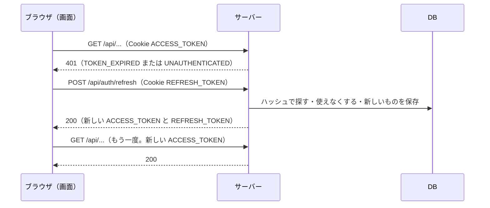

# 機能定義書：認証（新規登録・ログイン・ログアウト）

| 項目 | 内容 |
|---|---|
| 対象の機能 | A-01〜A-04（[機能一覧](../features.md) 1.1） |
| 版 | 0.2（2026-11-08） |

## 1. 概要

メールアドレスとパスワードでアカウントを作り、ログインする。ログインの状態は JWT（ログインしていることを示す、サーバーが署名した証明書）で保つ（講義の方針）。

JWT は **アクセストークン（15分）** とし、期限が切れたら **リフレッシュトークン（7日）** で自動で新しくする（7章）。

## 2. 誰が使えるか

| 機能 | 使える人 |
|---|---|
| 新規登録・ログイン | ログインしていない人 |
| ログアウト | ログインしている人 |

ログインしている人が新規登録・ログインの画面を開いたら、タイムラインへ移す。

## 3. 入力と制限

### 3.1 新規登録（A-01）

| 項目 | 必須 | ルール |
|---|---|---|
| メールアドレス | ○ | メールアドレスの形式。254文字まで。大文字は小文字にそろえて保存する。登録済みのものは不可 |
| パスワード | ○ | 8〜64文字。半角の英数字と記号 |
| パスワード（確認） | ○ | パスワードと同じであること（画面だけで確かめる） |
| ユーザー名 | ○ | 3〜15文字。半角の英数字と `_`（アンダーバー）。大文字・小文字は区別しない（`Taro` と `taro` は同じ）ので、小文字にそろえて保存する。登録済みのものは不可。あとから変えられない |
| 表示名 | ○ | 1〜50文字（絵文字も1文字と数える）。前後の空白は取り除く |

### 3.2 ログイン（A-02）

| 項目 | 必須 | ルール |
|---|---|---|
| メールアドレス | ○ | 大文字・小文字は区別しない |
| パスワード | ○ | |

- 同じ接続元（IP アドレス）からのログインの失敗は、15分に10回まで（要件 N-23）。11回目からは、正しいパスワードでも断る

## 4. 処理の流れ

### 4.1 新規登録

1. 画面で入力をチェックする（3.1）
2. サーバーでもう一度チェックする。メールアドレスとユーザー名が登録済みでないか確かめる（同時に同じものが登録されたときも、DB の一意制約で止めて同じエラーにする）
3. パスワードを BCrypt でハッシュ化（元に戻せない形）して `users` に保存する
4. アクセストークンとリフレッシュトークンを作り、HttpOnly の Cookie に入れて返す（自動でログインした状態になる）
5. タイムライン（S-03）の「すべて」タブへ移る（フォローしている人がまだいないため）。タイムラインを作るまでは、仮のホーム画面へ移る

### 4.2 ログイン

1. メールアドレスで `users` を探し、パスワードのハッシュを照らし合わせる。登録されていないメールアドレスでも照らし合わせを1回して、答えが返るまでの時間で登録の有無を推測させない
2. 合っていれば2つのトークンを Cookie に入れて返し、タイムライン（S-03）へ移る。ログイン画面を開く前に別の画面を開こうとしていたなら、その画面へ戻す

### 4.3 ログアウト

1. DB のリフレッシュトークンを取り消し、2つの Cookie を消す
2. ログイン画面（S-01）へ戻る

### 4.4 ログインしていない人（A-04）

- 画面：新規登録・ログイン以外の画面を開いたら、ログイン画面へ移す
- サーバー：アクセストークンがない・正しくない・期限切れの要求は 401 で断る
- 画面は 401 を受けたら、まずリフレッシュトークンで更新を試す（7.3）。更新もできなければログイン画面へ移し、「ログインの有効期限が切れました。もう一度ログインしてください」と出す

## 5. エラーのとき

| 場面 | 表示する文言 | API の code |
|---|---|---|
| メールアドレスの形式が違う | 「メールアドレスの形式で入力してください」 | VALIDATION_ERROR |
| メールアドレスが登録済み | 「このメールアドレスは登録済みです」 | EMAIL_DUPLICATED |
| ユーザー名が登録済み | 「このユーザー名は使われています」 | USERNAME_DUPLICATED |
| ユーザー名の形式が違う | 「ユーザー名は3〜15文字の半角英数字と _ で入力してください」 | VALIDATION_ERROR |
| パスワードの形式が違う | 「パスワードは8〜64文字の半角英数字・記号で入力してください」 | VALIDATION_ERROR |
| 表示名が空・長すぎる | 「表示名を入力してください」「表示名は50文字以内で入力してください」 | VALIDATION_ERROR |
| 確認のパスワードが違う | 「パスワードが一致しません」 | （画面だけ） |
| ログインの失敗 | 「メールアドレスまたはパスワードが正しくありません」（どちらが違うかは教えない） | LOGIN_FAILED |
| 失敗が多すぎる | 「しばらくしてから再度お試しください」 | RATE_LIMITED |
| ログインの期限切れ（更新もできない） | 「ログインの有効期限が切れました。もう一度ログインしてください」 | REFRESH_INVALID |

## 6. 関係する画面・テーブル

- 画面：S-01 ログイン、S-02 新規登録（[screen-design.md](../screen-design.md)）
- テーブル：`users`・`refresh_tokens`（[database-design.md](../database-design.md)）

## 7. ログインの状態の保ち方

### 7.1 2つのトークン

| | アクセストークン | リフレッシュトークン |
|---|---|---|
| 役目 | API を呼ぶたびに見せる「入場券」 | 入場券が切れたときに、新しい入場券をもらう「引換券」 |
| 中身 | JWT（subject＝ユーザー ID。HMAC-SHA256 で署名。道具は jjwt） | 32バイトのランダムな文字列（JWT ではない） |
| 期限 | 15分 | 7日（使うたびに取り替えるので、7日以内に使えばログインが続く） |
| サーバーの記録 | 持たない（署名と期限だけで確かめる） | `refresh_tokens` に **SHA-256 のハッシュだけ** を保存（DB が漏れても使えない） |
| Cookie の名前 | `ACCESS_TOKEN` | `REFRESH_TOKEN` |
| Cookie の Path | `/`（すべての API に送る） | `/api/auth`（ログイン関係の API にだけ送る） |
| Cookie の属性 | HttpOnly・Secure・SameSite=Lax | 同じ |

- **HttpOnly**：画面の JavaScript から読めない。XSS（悪いスクリプトを埋め込まれる攻撃）があっても、トークンを盗まれない（要件 N-27）
- **Secure**：HTTPS のときだけ送る。ブラウザは `localhost` を安全な場所として扱うので、開発中も付けたままでよい
- **SameSite=Lax**：ほかのサイトからの POST には付かない（CSRF の対策の1つ）

### 7.2 講義との違い（ユーザーが確認して決めた）

| | 講義 | このアプリ |
|---|---|---|
| JWT の送り方 | `Authorization: Bearer` ヘッダー（画面の JavaScript が JWT を持つ） | HttpOnly の Cookie（ブラウザが自動で送る） |
| CSRF 対策 | 無効 | **有効**（Cookie `XSRF-TOKEN`＋ヘッダー `X-XSRF-TOKEN` を照らし合わせる） |
| トークン | JWT 1つ | アクセストークン＋リフレッシュトークン |

**なぜ CSRF 対策が要るか**：CSRF は、悪いサイトがブラウザに勝手にリクエストを送らせる攻撃で、ブラウザが Cookie を自動で付けることを利用する。講義のようにヘッダーで送るなら、悪いサイトは JWT を付けられないので CSRF は起きない。このアプリは JWT を Cookie に入れるので、対策が要る。

**2つの方式の比べ**

| | Authorization ヘッダー（講義） | HttpOnly の Cookie（このアプリ） |
|---|---|---|
| CSRF | 起きない。対策はいらない | 起きうる。対策がいる（CSRF トークン・SameSite） |
| XSS で JWT を盗まれるか | 盗まれる | 盗まれない |
| 作り | 簡単 | 少し手間（トレロ風アプリと同じ仕組みを使う） |

### 7.3 自動の更新の流れ

- アクセストークンの Cookie は15分で消えるので、期限切れの後は「Cookie がない」（UNAUTHENTICATED）になることもある。画面はどちらの 401 でも更新を試す
- 同時にいくつかの API が 401 になっても、更新は1回にまとめる（画面の axios の仕組みで行う）
- 更新が 401（REFRESH_INVALID）なら、ログイン画面へ移す

### 7.4 使い回しの検知

- 取り替え済み（使用済み）のリフレッシュトークンがもう一度使われたら、**盗まれたとみなし、その人のリフレッシュトークンをすべて取り消す**。本人ももう一度ログインする必要がある
- 同じリフレッシュトークンで同時に2回更新したときも、DB の更新は片方だけが成功し、もう片方は使い回しとして扱う（同じブラウザの2つのタブで同時に起きると、ログアウトされることがある）
- 期限切れのリフレッシュトークンは、1日1回（4:00 UTC）まとめて消す。取り消したものも、期限までは残す（期限までに使い回されたら見つけるため）

### 7.5 そのほか

- ログアウトしても、アクセストークン（JWT）そのものは最大15分有効のまま残る。ただし Cookie を消すので、ブラウザからは送られない
- JWT の鍵は環境変数 `SNS_JWT_SECRET`（Base64。32バイト以上）。本番は AWS の Parameter Store に入れる

## 8. API

すべて JSON。エラーは Problem Details の形（`detail` に画面に出す文言、`code` に見分けるための名前、入力の誤りは `errors` に項目ごと）。POST はすべて CSRF トークン（ヘッダー `X-XSRF-TOKEN`）が必要。

| メソッド・URL | ログイン | 送るもの | 返事 |
|---|---|---|---|
| POST `/api/auth/signup` | 不要 | `email`・`password`・`username`・`displayName` | 201＋2つの Cookie＋本人（`id`・`email`・`username`・`displayName`）／400・409 |
| POST `/api/auth/login` | 不要 | `email`・`password` | 200＋2つの Cookie＋本人／401 `LOGIN_FAILED`／429 `RATE_LIMITED`（`Retry-After` ヘッダー） |
| POST `/api/auth/refresh` | 不要（Cookie `REFRESH_TOKEN` で確かめる） | なし | 200＋新しい2つの Cookie＋本人／401 `REFRESH_INVALID`（2つの Cookie を消す） |
| POST `/api/auth/logout` | 不要（期限切れでも Cookie を消せるように） | なし | 204（リフレッシュトークンを取り消し、2つの Cookie を消す） |
| GET `/api/auth/me` | 必要 | なし | 200＋本人／401 `TOKEN_EXPIRED`・`UNAUTHENTICATED` |

- CSRF トークンがない・合わない POST は 403 `CSRF_INVALID`
- Cookie `XSRF-TOKEN` は、どの API の返事にも付く（画面は最初に `GET /api/auth/me` を呼べば受け取れる）

## 9. この文書で新しく決めたこと（確認をお願いします）

- ユーザー名のルール（3〜15文字、半角英数字と `_`、あとから変えられない）。X に近い形。変えられないのは、URL（`/users/ユーザー名`）が変わらないようにするため
- 新規登録のあとは、自動でログインして「すべて」タブを開く
- アクセストークン15分・リフレッシュトークン7日（ユーザーの決定）。どちらも HttpOnly の Cookie（ユーザーの決定）
- リフレッシュトークンは JWT ではなくランダムな文字列にし、DB にはハッシュだけを保存する
- 同じタブで同時に更新が起きたときに、使い回しと区別できずログアウトされることがある（画面で更新を1回にまとめて防ぐ）
- ログイン失敗の回数制限はメモリに持つ簡単な形（サーバーを起動し直すと消える）。本番の接続元の取り方はデプロイのときに見直す

## 10. 改訂履歴

| 版 | 日付 | 内容 |
|---|---|---|
| 0.1 | 2026-11-08 | たたき台を作成 |
| 0.2 | 2026-11-08 | 実装に合わせて、アクセストークン＋リフレッシュトークン・Cookie・CSRF の仕組み（7章）と API（8章）を追加。講義との違いと理由を書いた |
