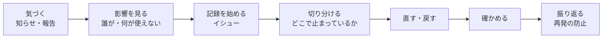

# 障害対応書：RaiseTechtimeline

| 項目 | 内容 |
|---|---|
| 版 | 0.1（2026-11-21） |
| 関係する文書 | [operations.md](operations.md)（運用設計書。監視の知らせ A1〜A5）・[logging.md](logging.md)（ログの見方）・[infrastructure.md](infrastructure.md)（AWS の構成） |
| 状態 | **デプロイの前のたたき台**。実際に起きた障害・デプロイで確かめたことで直す（「【デプロイで確かめる】」の印） |

障害（アプリが使えない・おかしい）が起きたときの手順。まず 1章の流れに沿って動き、2章の「よくある障害」から近いものを探す。

---

## 1. 障害が起きたときの流れ



| 段 | やること |
|---|---|
| 1. 気づく | 知らせのメール（operations.md 2.1 の A1〜A5）か、使った人の報告。報告には、画面に出た文言・日時・できれば `X-Request-Id`（ブラウザの開発者ツールの「ネットワーク」で見える返事のヘッダー）をもらう |
| 2. 影響を見る | 全員か一部の人か、全部の機能か一部か。データが消えた・漏れた疑いがあるか（あるなら 2.9 を先に） |
| 3. 記録を始める | GitHub にイシューを立てる（3章）。分かったこと・やったことを、時刻と一緒に書き足していく |
| 4. 切り分ける | 下の「どこで止まっているか」の順に見る |
| 5. 直す・戻す | 原因が分からなくても、**まず使える状態に戻すこと**を先にする（1つ前の版に戻す・起動し直すなど。operations.md 7.2） |
| 6. 確かめる | ログイン・投稿・画像の表示を試し、ERROR のログが止まったかを見る |
| 7. 振り返る | 原因・直し方・再発の防止をイシューに書いて閉じる。コードを直すなら、いつもの「イシュー → ブランチ → PR」で |

### 1.1 どこで止まっているか（外から順に）

```
利用者 → CloudFront → ALB → EC2 [ Nginx → Spring Boot ] → RDS
                                           └→ S3
```

| 見る順 | 確かめ方 | 止まっていたら |
|---|---|---|
| 1. CloudFront | CloudFront の住所を開く。CloudFront のエラーの画面が出るか | 2.1 |
| 2. ALB | CloudWatch で ALB の 5xx（`HTTPCode_ELB_5XX_Count`）とターゲットの状態（`UnHealthyHostCount`） | 2.1 |
| 3. EC2 | Session Manager で入り、`systemctl status` で Spring Boot と Nginx が動いているか | 2.1・2.6 |
| 4. Spring Boot | CloudWatch Logs で ERROR のログ（logging.md 7.2） | 2.2 |
| 5. RDS・S3 | ログの例外の種類（`error.type`）で、DB か S3 かを見る | 2.5・2.4 |

- EC2 には SSH ではなく **Session Manager** で入る（infrastructure.md 6.1）

## 2. よくある障害

### 2.1 画面が開かない（502・503・504）

| 項目 | 内容 |
|---|---|
| 症状 | CloudFront の住所を開くと「502 Bad Gateway」「503 Service Unavailable」「504 Gateway Timeout」。知らせ A1・A2 |
| 見る場所 | ALB のターゲットの状態（ヘルスチェック）・EC2 の `systemctl status nginx`・`systemctl status`（Spring Boot のサービス）・`journalctl -u`（そのサービスのログ） |
| 切り分け | **502**：ALB から EC2 の Nginx につながらない（Nginx が止まった・セキュリティグループ）。または Nginx から Spring Boot につながらない（Spring Boot が止まった・起動中）／**503**：ALB の後ろに生きた EC2 がない（ヘルスチェックが失敗）／**504**：Spring Boot が返事をしない（重い処理・DB を待っている。2.5・2.7） |
| 直し方 | 止まっているサービスを起動し直す（`systemctl restart`）。起動しない：`journalctl` で理由を見る（設定が読めない・DB につながらない・ポートが使われている）。デプロイの直後なら、1つ前の版に戻す（operations.md 7.2） |
| 再発の防止 | systemd に「落ちたら自動で起動し直す」（`Restart=on-failure`）を入れる【デプロイで確かめる】。落ちた原因（メモリ不足など）を直す |

### 2.2 API が 500 を返す（「通信に失敗しました」などが出る）

| 項目 | 内容 |
|---|---|
| 症状 | 画面に「投稿に失敗しました。時間をおいて再度お試しください」「読み込みに失敗しました」など。知らせ A1・A3 |
| 見る場所 | CloudWatch Logs Insights で ERROR の行（logging.md 7.2 の1つ目の例）。報告に `X-Request-Id` があれば、その ID で1つのリクエストのログをすべて出す（2つ目の例） |
| 切り分け | `error.type`・`error.stack_trace` で、どこで失敗したかを見る。DB の例外（`DataAccessException` など）→ 2.5、S3 の例外（`S3Exception`・`SdkClientException`）→ 2.4、それ以外はアプリの不具合 |
| 直し方 | アプリの不具合：起きる条件（どの API・どの入力）をログとアクセスログで確かめ、手元で同じことを起こしてテストを書き、直す（TDD 風。testing.md）。急ぐなら1つ前の版に戻す |
| 再発の防止 | 直した不具合のテストを足す。ERROR にすべきでないもの（利用者の入力の誤り）が ERROR になっていたら、決まった 4xx を返すように直す（logging.md 4章） |

### 2.3 ログインできない・すぐログアウトされる

| 項目 | 内容 |
|---|---|
| 症状 | 正しいパスワードでも「メールアドレスまたはパスワードが正しくありません」／「ログインの有効期限が切れました」がすぐ出る／ログインしてもすぐログイン画面に戻る |
| 見る場所 | アクセスログの `/api/auth/login`・`/api/auth/refresh` の `status`。WARN のログ（「ログインに失敗しました」「ログインの失敗が多すぎるため断りました」「使用済みのリフレッシュトークンが使われたため…」） |
| 切り分け | **429**（「しばらくしてから再度お試しください」）：回数制限。本番では接続元が Nginx の住所になり、**全員が同じ接続元に見えて**まとめて止められている疑い（logging.md 8章・infrastructure.md 5章）／**ログインの直後に 401・POST がすべて 403**：Cookie（ログインの Cookie・`XSRF-TOKEN`）やヘッダー `X-XSRF-TOKEN` が Spring Boot まで届いていない。CloudFront は設定によって Cookie・ヘッダーを ALB へ渡さないので、`/api/*` で「すべて渡す」設定になっているかを見る（アクセスログの `status` と、ブラウザの開発者ツールで送った Cookie を比べる）。ログインの Cookie の Secure は設定（`app.auth.cookie-secure`）で付けるので、HTTPS の伝え方には左右されない／**JWT の鍵**：EC2 ごとや起動ごとに鍵が違うと、作った JWT が読めない（Parameter Store の値を確かめる。値そのものは表示しない）／**時計**：EC2 の時計が大きくずれると、JWT の期限がおかしくなる（`timedatectl`）／**「使用済みのリフレッシュトークン」の WARN**：盗まれた疑いとして、その人のトークンをすべて取り消した（同じ人が2つのタブで同時に延ばしたときにも起きる。authentication.md 7.4） |
| 直し方 | 接続元の取り方は、Nginx と Spring Boot の設定を直す（`X-Forwarded-For` を正しく引き継ぐ。infrastructure.md 5章）。Cookie・ヘッダーは CloudFront の `/api/*` の設定を直す（Terraform）。回数制限は、Spring Boot を起動し直すと消える（メモリに持っているため。authentication.md 9章）。鍵の違いは Parameter Store の値をそろえて起動し直す |
| 再発の防止 | 【デプロイで確かめる】デプロイのときに、2つの別の接続元からログインを失敗させて、片方だけが止められることを確かめる |

### 2.4 画像・動画が出ない・送れない

| 項目 | 内容 |
|---|---|
| 症状 | 投稿の画像が表示されない（壊れた画像の印）／「画像の送信に失敗しました」「動画の送信に失敗しました」 |
| 見る場所 | ブラウザの開発者ツールの「ネットワーク」と「コンソール」（S3 からの 403・CORS のエラー・CSP〈読み込んでよいものの決まり〉のエラー）。ERROR・WARN のログ（S3 の例外） |
| 切り分け | **1時間ほどたってから出なくなった**：表示用の期限付き URL の期限切れ（1時間。post.md 7章）。再読み込みで直る（不具合ではない）／**最初から出ない・403**：EC2 のロールに S3 の権限がない・バケット名の違い／**動画だけ送れない**：S3 の CORS に CloudFront の住所が入っていない・期限付きの送り先 URL（15分）の期限切れ／**CSP のエラー**：画面の CSP の S3 の住所（`vite.config.ts`）がバケットと合わない／**画像の送信だけ 500**：EC2 で WebP の道具（libwebp）が動かない（infrastructure.md 改訂 0.5） |
| 直し方 | 権限・CORS・バケット名は Terraform を直して `apply`。CSP は画面を直してビルドし直す。WebP の道具は EC2 に入れる（【デプロイで確かめる】） |
| 再発の防止 | デプロイの確認（operations.md 7.1）に「画像1枚・動画1本を投稿して表示する」を入れる |

### 2.5 DB に届かない

| 項目 | 内容 |
|---|---|
| 症状 | ほとんどの API が 500。ログに DB の例外（つながらない・時間切れ・パスワードが違う）。知らせ A1・A3 |
| 見る場所 | RDS の状態（動いているか・止まっているか）・RDS の `DatabaseConnections`・`CPUUtilization`・`FreeStorageSpace`（知らせ A4）。ログの `error.message` |
| 切り分け | **止まっている**：手で止めた・メンテナンス中／**パスワードが違う**：Parameter Store の値と RDS のパスワードが合わない（入れ替えの途中。operations.md 8章）／**つながらない**：RDS のセキュリティグループが EC2 からを許していない（Terraform の変更のあと）／**容量がいっぱい**：書き込みが失敗する |
| 直し方 | 起動する・パスワードをそろえて Spring Boot を起動し直す・セキュリティグループを直す。容量は RDS のストレージを増やす（Terraform）。データがおかしくなったときは、自動バックアップから戻す（operations.md 5章。新しい RDS ができる） |
| 再発の防止 | 容量の知らせ（A4）が早めに来るよう、数字を見直す |

### 2.6 EC2 のディスク・メモリがいっぱい

| 項目 | 内容 |
|---|---|
| 症状 | Spring Boot が落ちる・起動しない。画像の送信が失敗する（一時ファイルが書けない）。知らせ A2 |
| 見る場所 | Session Manager で `df -h`（ディスク）・`free -m`（メモリ）・`journalctl --disk-usage`（systemd のログの量） |
| 切り分け | **ディスク**：systemd のログ（journal）が溜まった・一時ファイル（画像の縮小の途中のファイル）が残った／**メモリ**：Java が使うメモリの上限が EC2 の大きさに合っていない（落ちると `journalctl` に「OutOfMemoryError」か、OS に止められた記録） |
| 直し方 | `journalctl --vacuum-time=7d` で古いログを消す。残った一時ファイルを消す（WARN「一時ファイルを消せませんでした」の場所）。メモリは Java の上限（`-Xmx`）を見直すか、EC2 を大きくする |
| 再発の防止 | journal の大きさの上限（`SystemMaxUse`）を決める【デプロイで確かめる】。ログは CloudWatch Logs に送っているので、EC2 に長く残さなくてよい |

### 2.7 遅い

| 項目 | 内容 |
|---|---|
| 症状 | タイムラインがなかなか出ない（N-12：最初の20件はおおむね1秒以内が目標） |
| 見る場所 | アクセスログの `durationMs`（logging.md 7.2 の「遅い API」「API ごとの平均」）。EC2・RDS の CPU |
| 切り分け | 特定の API だけ遅い：SQL（索引がない・N+1。開発で `DEBUG` の SQL のログを見る）／全部遅い：EC2 か RDS が小さすぎる・CPU が使い切られている |
| 直し方 | SQL：索引を足す（Flyway の新しいファイル）・SQL の回数を減らす（N+1 のテストで確かめる。`SqlCounter`）。全部：EC2・RDS を大きくする（費用が増えるので、先に相談） |
| 再発の防止 | 遅かった API のテストに、SQL の回数のテストを足す |

### 2.8 費用が急に増えた

| 項目 | 内容 |
|---|---|
| 症状 | AWS Budgets のメール（知らせ A5） |
| 見る場所 | Cost Explorer（サービスごと・日ごとの費用） |
| 切り分け | 片付け忘れ（`terraform destroy` を忘れた・Terraform の外で作ったもの）／ログの量が多すぎる（CloudWatch Logs）／通信が多い（動画をたくさん見られた・おかしなアクセス）／シドニー以外のリージョンに何かある |
| 直し方 | 使っていないなら片付ける（operations.md 4.2）。おかしなアクセスなら 2.9 |
| 再発の防止 | 使い終わったら片付ける、をデプロイの手順の最後に入れる |

### 2.9 不正なアクセス・漏えいの疑い

| 項目 | 内容 |
|---|---|
| 症状 | WARN「ログインに失敗しました」が1つの接続元から大量／「使用済みのリフレッシュトークンが使われた」が何度も／知らない投稿・設定の変更／秘密の値を Git やログに出してしまった |
| 見る場所 | CloudWatch Logs Insights で WARN（`clientIp`・`userId` ごとに数える）。GitHub の履歴 |
| 切り分け | 総当たり（同じ接続元から何度も）→ 回数制限で止まっているか／トークンの盗用 → その人のトークンはアプリが取り消している（authentication.md 7.4）／秘密の値の漏えい → どの値か |
| 直し方 | **秘密の値が漏れたら、すぐ入れ替える**（operations.md 8章。Git から消すだけでは足りない。履歴に残るため）。広く疑わしいときは、全員を強制的にログアウトさせる（同 8章）。止まらない攻撃は、CloudFront・ALB の前で断る仕組み（AWS WAF。費用がかかる）を相談する |
| 再発の防止 | 漏れた原因（どこに書いたか）を直し、`security-review`・`claude-security` で確かめる |

## 3. 記録の残し方

- 障害ごとに GitHub にイシューを1つ立て、ラベル `incident` を付ける（ラベルは最初の障害のときに作る）
- タイトル：`障害: 〈症状〉（日付）`（例：`障害: 画面が開かない 503（2026-12-01）`）
- 本文は次の見出しで書く。分かったことを時刻と一緒に足していく

```markdown
## 起きたこと
- 気づいた時刻・どうやって気づいたか（知らせ A1 など／報告）
- 影響：誰が・何が使えなかったか・いつからいつまで

## 時系列
- 10:05 知らせ A1（5xx）が来た
- 10:10 ALB のターゲットが Unhealthy。EC2 の Spring Boot が止まっていた
- 10:15 起動し直して直った

## 原因

## 直し方（やったこと）

## 再発の防止
- [ ] 〈直すこと〉（イシュー #○）
```

- ログを貼るときは、メールアドレス・トークン・秘密の値が入っていないかを確かめる（ふつうは入らない。logging.md 6章）
- 連絡：運用は自分1人なので、連絡先は自分だけ。使っている人（講座の確認の人など）がいれば、使えないことと、直る見込みを伝える

## 4. この文書で新しく決めたこと（確認をお願いします）

- 障害の記録は GitHub のイシュー（ラベル `incident`）に残す。決まった見出し（3章）で書く
- 原因が分からなくても、まず使える状態に戻すこと（戻す・起動し直す）を先にする
- systemd に「落ちたら自動で起動し直す」を入れる・journal の大きさの上限を決める（デプロイのときに）
- デプロイのときに、接続元の取り方（回数制限）を2つの接続元で試し、CloudFront が Cookie と CSRF のヘッダーを渡すことを確かめる

## 5. 改訂履歴

| 版 | 日付 | 内容 |
|---|---|---|
| 0.1 | 2026-11-21 | たたき台を作成（イシュー #57） |
