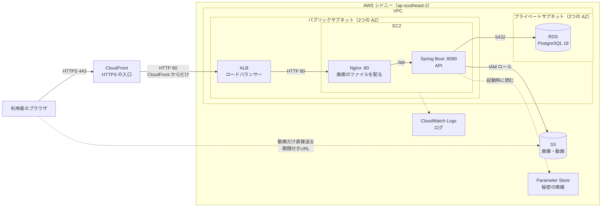

# インフラ構成：RaiseTechtimeline

| 項目 | 内容 |
|---|---|
| 版 | 0.4 |
| 作成日 | 2026-11-08 |
| 状態 | **現時点の案**（EC2・RDS の細かい設定は、講義に合わせて後で決める） |
| リージョン | シドニー（ap-southeast-2）。**東京は使わない** |

---

## 1. 構成概要（設計方針）

講義の方針どおり、**ALB → EC2 → RDS** の形にし、画像・動画は **S3** に保存する。HTTPS は、ALB の前に置いた **CloudFront** で付ける（ユーザーの決定。独自ドメインを取らずに済む）。

| 方針 | 内容 |
|---|---|
| 入口は CloudFront だけ | 利用者が開くのは CloudFront の住所（`https://xxxx.cloudfront.net`）。CloudFront が HTTPS を受け、ALB へ渡す。ALB は CloudFront からの通信だけを受け付ける。EC2・RDS には直接届かない |
| HTTPS | CloudFront に最初から付いている証明書（`*.cloudfront.net`）を使う。**独自ドメインは使わない**（ユーザーの決定）ので、ACM の証明書・Route 53 もいらない |
| 画面と API は同じ EC2 | EC2 の中の Nginx が、画面のファイル（React をビルドしたもの）を配り、`/api` を Spring Boot へ転送する。画面と API が同じ住所になるので、CORS（別の住所からの通信の許可）の設定がいらない |
| DB は RDS | PostgreSQL 18。インターネットには出さない |
| 画像・動画は S3 | バケットは公開しない。画面には期限付きの URL を渡す。画像は EC2 を通して保存し、大きい動画はブラウザから S3 へ直接送る（EC2 が作った期限付きの送り先 URL を使う） |
| 秘密の情報 | DB のパスワード・JWT の鍵は Parameter Store に入れる。コードや Git には書かない |
| 作り方 | **Terraform**（AWS の部品をコードで書いて作る道具。講義と同じ）。ファイルは `terraform/`。作り直しや片付け（`terraform destroy`）がコマンドでできる |
| 費用 | まずは最小の構成（1台ずつ）。使わないときは止める・片付ける |

---

## 2. アーキテクチャ図



テキストで書くと：

```
利用者 ──HTTPS──▶ CloudFront ──HTTP──▶ ALB ──HTTP──▶ EC2 [ Nginx ─/api─▶ Spring Boot ] ──▶ RDS (PostgreSQL)
                                                                         │
                                                                         └──▶ S3（画像・動画）
利用者 ──動画だけ、期限付きの URL で直接（HTTPS）──▶ S3
```

- CloudFront は世界中にある AWS の配信の拠点。シドニーリージョンを選ぶものではなく、AWS 全体で1つ作る
- CloudFront から ALB までは HTTP（AWS の中の通信）。ALB に HTTPS を付けるには独自ドメインが必要なため（トレロ風アプリと同じ形）

---

## 3. AWS サービス一覧

| サービス | 役割 | 現時点の案 |
|---|---|---|
| CloudFront | 入口。HTTPS を受けて ALB へ渡す | 1つ。HTTP で来たら HTTPS へ移す。`/api/*` はキャッシュしない（毎回 ALB へ）。画面のファイル（JS・CSS）はキャッシュしてよい |
| VPC | AWS の中の自分専用のネットワーク | パブリックサブネット2つ・プライベートサブネット2つ（ALB と RDS は2つの AZ〈データセンターの場所〉が必要） |
| ALB（Application Load Balancer） | CloudFront から受けて EC2 へ渡す | 1つ。HTTP（80）。CloudFront からの通信だけを受け付ける（6.1） |
| EC2 | アプリを動かすサーバー | 1台。Amazon Linux 2023（大きさは後で決める） |
| RDS | PostgreSQL のデータベース | PostgreSQL 18、1台（大きさは後で決める）。自動バックアップ7日 |
| S3 | 画像・動画（投稿の画像・動画、アイコン）の保存 | バケット1つ。公開しない。暗号化。`tmp/`（送信中の動画）は1日で自動で消す（ライフサイクルの設定）。ブラウザから動画を直接送れるよう、CloudFront の住所からの PUT だけを許す（CORS の設定） |
| IAM | 権限の管理 | EC2 にロールを付け、S3 のそのバケットと Parameter Store の読み取りだけを許す |
| Systems Manager（Parameter Store・Session Manager） | 秘密の情報の保管、EC2 へのログイン | SSH（22番）は開けず、Session Manager で入る |
| CloudWatch | ログ・監視 | アプリのログを送る。14日保存 |
| AWS Budgets | 料金の見張り | 料金が発生しそうなときにメール |

---

## 4. EC2 サーバー構成

| 項目 | 内容 |
|---|---|
| OS | Amazon Linux 2023 |
| Java | Amazon Corretto 25（Java 25） |
| Spring Boot | ビルドした jar を systemd（サーバーの起動・停止の仕組み）で動かす。ポート 8080。専用のユーザーで動かし、root では動かさない |
| Nginx | ポート 80。画面のファイルを配り、`/api` を Spring Boot へ |
| 画面のファイル | React を **Node.js 24** でビルドしたもの（`dist/`）を置く。ビルドする場所（パソコン・GitHub Actions・EC2）はデプロイの方法と一緒に決める |
| 設定 | DB の接続先・パスワード、JWT の鍵、S3 のバケット名は、起動時に Parameter Store から読む |

## 5. Nginx 構成（リバースプロキシ＝受け取った要求を裏のサーバーへ回す役）

| URL | 行き先 |
|---|---|
| `/api/...` | Spring Boot（`http://127.0.0.1:8080`） |
| それ以外 | 画面のファイル。ない URL は `index.html` を返す（React Router が画面を切り替えるため） |

- 画像のアップロード（1枚5MB×4枚）が通るように、受け取る大きさの上限（`client_max_body_size`）を少し大きめ（例：25MB）にする。動画は S3 へ直接送るので、Nginx は通らない
- セキュリティのヘッダー（他サイトへの埋め込みの禁止、HTTPS の強制など）を付ける
- 接続元の情報（`X-Forwarded-For` など）は CloudFront → ALB の順に足されたものを正しく引き継ぐ。利用者が自分で付けた値をそのまま信じない（ログイン失敗の回数制限〈要件 N-23〉で接続元を使うため）
- 利用者とは HTTPS でつながっているので、ログインの Cookie には Secure を付ける（EC2 には HTTP で届くが、CloudFront が HTTPS で受けたことを Spring Boot に伝える）

## 6. セキュリティ（ポート・アクセス制限）

### 6.1 セキュリティグループ（通信の許可の一覧）

| 相手 | 受け付けるポート | どこから |
|---|---|---|
| ALB | 80 | **CloudFront からだけ**（AWS が用意している CloudFront の住所の一覧〈マネージドプレフィックスリスト〉を使う） |
| EC2 | 80 | **ALB のセキュリティグループからだけ** |
| RDS | 5432 | **EC2 のセキュリティグループからだけ** |

- CloudFront の住所の一覧は、ほかの人の CloudFront も含む。そこで、CloudFront から ALB へ送るときに秘密の値のヘッダーを付け、ALB はそのヘッダーがある通信だけを EC2 へ渡す（ALB の住所に直接来た通信を断る）
- EC2 の 22（SSH）と 8080（Spring Boot）は外に開けない
- RDS は「インターネットから使えない」設定（`publicly_accessible = false`）にし、プライベートサブネットに置く

### 6.2 そのほか

| 項目 | 内容 |
|---|---|
| S3 | 「パブリックアクセスをすべてブロック」を有効。読み書きは EC2 のロールと、EC2 が作った期限付きの URL からだけ |
| 暗号化 | RDS・S3 は保存するデータを暗号化。利用者との通信は HTTPS（CloudFront） |
| 秘密の情報 | Parameter Store（`SecureString`＝暗号化して保存） |

## 7. デプロイ手順（概要）

詳しい手順は、AWS の講義を受けてから決める。1〜3・6・7 の AWS の部品は Terraform で作る。

1. AWS にネットワーク（VPC・サブネット・セキュリティグループ）を作る
2. RDS・S3・Parameter Store を用意する
3. EC2 を作り、Java 25・Nginx を入れる
4. Spring Boot を jar にビルドして EC2 に置き、systemd で起動する（起動時に Flyway がテーブルを作る）
5. React を Node.js 24 でビルドし、できたファイルを EC2 の Nginx の場所に置く
6. ALB を作り、EC2 につなぐ
7. CloudFront を作り、ALB につなぐ。ALB を CloudFront からだけ受け付ける設定にする。S3 の CORS に CloudFront の住所を入れる
8. ブラウザで CloudFront の住所（`https://xxxx.cloudfront.net`）を開き、ログイン・投稿・画像と動画の表示を確かめる

## 8. 未決事項

| 項目 | 選択肢 |
|---|---|
| EC2・RDS の大きさ | 講義で決める |
| 画面のビルドの場所 | パソコン・GitHub Actions・EC2 |
| 動画の配信 | 今は S3 の期限付き URL から直接。見る人が増えて費用や速さが気になったら、S3 も CloudFront から配る |

## 9. 改訂履歴

| 版 | 日付 | 内容 |
|---|---|---|
| 0.1 | 2026-11-08 | 講義の方針（ALB・EC2・RDS・S3）をもとに、現時点の案を作成 |
| 0.2 | 2026-11-08 | 動画の追加に合わせ、動画はブラウザから S3 へ直接送る形にした。S3 のライフサイクル・CORS、Nginx の上限を変更 |
| 0.3 | 2026-11-08 | HTTPS は ALB の前に置いた CloudFront で付けることにした（ユーザーの決定）。ALB は CloudFront からだけ受け付ける。独自ドメインは使わない（ユーザーの決定。ACM・Route 53 も使わない） |
| 0.4 | 2026-11-08 | AWS は Terraform で作ることにした（講義に合わせたユーザーの判断）。未決事項から外した |
