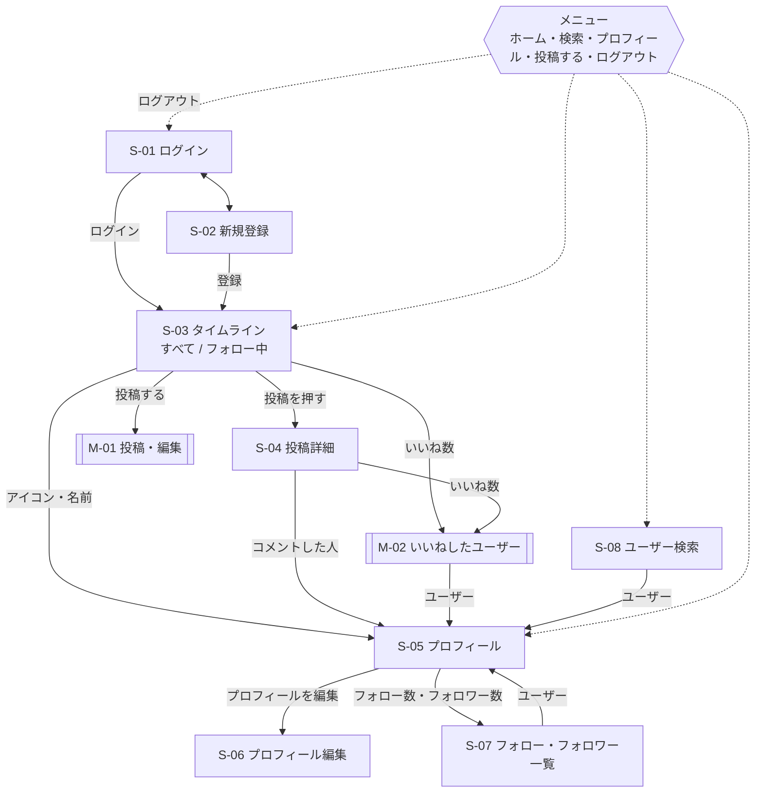

# 画面設計書：RaiseTechtimeline

| 項目 | 内容 |
|---|---|
| 版 | 0.2 |
| 作成日 | 2026-11-08 |
| 状態 | たたき台（ユーザーの確認待ち） |

画面の文言・動きの細かい決まりは、各機能定義書（`features/`）にある。この文書は、画面の一覧・移り変わり・並べ方をまとめる。

---

## 1. 画面の一覧

ID の頭文字：S = 画面（Screen）、M = モーダル（画面の上に重ねて開く小さな画面）。

| ID | 画面 | URL | ログイン | 主な機能 |
|---|---|---|---|---|
| S-01 | ログイン | `/login` | 不要 | A-02 |
| S-02 | 新規登録 | `/signup` | 不要 | A-01 |
| S-03 | タイムライン | `/` | 必要 | TL-01〜TL-04、P-01、L-01 |
| S-04 | 投稿詳細 | `/posts/{投稿ID}` | 必要 | P-02、C-01〜C-05、L-01・L-04 |
| S-05 | プロフィール | `/users/{ユーザー名}` | 必要 | PF-01、FL-01〜FL-03 |
| S-06 | プロフィール編集 | `/settings/profile` | 必要 | PF-02 |
| S-07 | フォロー・フォロワー一覧 | `/users/{ユーザー名}/following`・`/followers` | 必要 | FL-04 |
| S-08 | ユーザー検索 | `/search?q=…` | 必要 | US-01 |
| S-09 | エラー（見つからない） | ない URL すべて | — | |
| M-01 | 投稿・編集 | S-03 などの上に開く | 必要 | P-01・P-03 |
| M-02 | いいねしたユーザー | S-03・S-04・S-05 の上に開く（投稿・コメントの両方） | 必要 | L-03・L-04 |
| M-03 | 確認ダイアログ | 削除・フォロー解除・編集の破棄の前 | 必要 | P-04・C-04・FL-01 |

---

## 2. 画面の移り変わり



---

## 3. 全画面に共通の決まり

### 3.1 並び方（レイアウト）

X に近い、縦長の1列を中心にした並び方。

| 画面の幅 | 並び方 |
|---|---|
| パソコン（1024px 以上） | 左にメニュー（縦）、真ん中にメイン（幅 600px）。右は空ける |
| タブレット（768〜1023px） | 左にアイコンだけのメニュー、真ん中にメイン |
| スマホ（767px 以下） | 上に画面の名前、下にメニュー（横並びのアイコン）。「投稿する」は右下の丸いボタン |

- 横幅 320px でも崩れず、横にはみ出さないこと（要件 N-01）

### 3.2 メニュー（S-01・S-02 以外の全画面）

| 項目 | 行き先 |
|---|---|
| ホーム | S-03 タイムライン |
| 検索 | S-08 ユーザー検索 |
| プロフィール | S-05（自分） |
| 投稿する | M-01 を開く |
| 自分のアイコン・名前 → ログアウト | ログアウトして S-01 |

### 3.3 見た目

- 部品（ボタン・入力欄・タブ・モーダル・通知など）は **Material UI** のものを使う（[tech-stack.md](tech-stack.md)）
- 色・文字の決まり（Material UI のテーマ）は、画面を作るときに決める（スキル `frontend-design` を使う）。この文書では並び方と中身だけを決める
- 押せるものはボタンかリンクにし、キーボードでも操作できるようにする

### 3.4 通知（画面の下に少しの間だけ出るメッセージ）

| 場面 | 文言 |
|---|---|
| 投稿した | 「投稿しました」 |
| 投稿を編集した | 「投稿を更新しました」 |
| 投稿を削除した | 「投稿を削除しました」 |
| コメントを削除した | 「コメントを削除しました」 |
| プロフィールを保存した | 「プロフィールを更新しました」 |
| 通信の失敗 | 「通信に失敗しました。時間をおいて再度お試しください」 |

### 3.5 読み込み中・空のとき

- 読み込み中は、一覧の形をした灰色の仮の表示（スケルトン）を出す
- 空のときの文言は、各機能定義書のとおり

---

## 4. 画面ごとの内容（ワイヤーフレーム）

### S-01 ログイン

```
┌──────────────────────────────┐
│        RaiseTechtimeline      │
│                              │
│  メールアドレス [__________]  │
│  パスワード     [__________]  │
│                              │
│        [  ログイン  ]         │
│                              │
│  アカウントをお持ちでない方は  │
│        新規登録 →             │
└──────────────────────────────┘
```

### S-02 新規登録

```
┌──────────────────────────────┐
│        アカウントを作成        │
│  メールアドレス     [_______] │
│  ユーザー名  @      [_______] │
│    3〜15文字の半角英数字と _   │
│  表示名             [_______] │
│  パスワード         [_______] │
│  パスワード（確認） [_______] │
│                              │
│        [  登録する  ]         │
│  アカウントをお持ちの方は ログイン → │
└──────────────────────────────┘
```

### S-03 タイムライン（メイン）

```
┌────────┬────────────────────────────────────┐
│ ロゴ    │  [ すべて ]  [ フォロー中 ]         │ ← タブ
│ ホーム  ├────────────────────────────────────┤
│ 検索    │ (icon) いまどうしてる？              │ ← 投稿の入力欄
│ プロフィール│ [画像][動画] 残り 280  [投稿する] │
│[投稿する]├────────────────────────────────────┤
│        │ (icon) 山田 太郎 @taro · 3分前   …  │ ← … は自分の投稿だけ
│        │ 今日は Spring Boot を勉強した。      │
│        │ ┌──────┬──────┐                    │
│        │ │ 画像1 │ 画像2 │ ← 4枚までを並べる   │
│        │ ├──────┼──────┤   （動画なら ▶ 付き） │
│        │ │ 画像3 │ 画像4 │                    │
│        │ └──────┴──────┘                    │
│        │ 💬 2    ♡ 5                         │
│        ├────────────────────────────────────┤
│ (icon) │ (icon) 佐藤 花子 @hanako · 1時間前   │
│ 自分 ▾  │ ...                                 │
└────────┴────────────────────────────────────┘
          （下までスクロールで続きを読み込む）
```

### S-04 投稿詳細

```
┌────────────────────────────────────┐
│ ←  投稿                             │
├────────────────────────────────────┤
│ (icon) 山田 太郎 @taro              … │
│ 今日は Spring Boot を勉強した。      │
│ [画像（4枚まで）か動画]               │
│ 2026年11月8日 14:05 · 編集済み       │
│ 💬 2    ♡ 5（数を押すと M-02）        │
├────────────────────────────────────┤
│ (icon) [コメントを入力______] 残り280 │
│                       [コメントする] │
├────────────────────────────────────┤
│ (icon) 佐藤 花子 @hanako · 10分前     │
│        がんばって！    [フォローする] │ ← コメントした人をフォロー
│        ↩ 返信 2   ♡ 3               │ ← 返信・コメントへのいいね
│        ▼ 返信を表示（2件）            │
│    ┌──────────────────────────────┐ │
│    │ (icon) 自分 @me · 2分前  [削除] │ │ ← 返信は1段だけ字下げ
│    │ ありがとう                     │ │
│    │ ↩ 返信 1   ♡ 1                 │ │
│    ├──────────────────────────────┤ │
│    │ (icon) 佐藤 花子 @hanako · 1分前 │ │
│    │ 返信先：@me                    │ │ ← 返信への返信は同じ段に並べる
│    │ どういたしまして！              │ │
│    │ ↩ 返信    ♡                    │ │
│    └──────────────────────────────┘ │
└────────────────────────────────────┘
```

- 「↩ 返信」を押すと、そのコメントのすぐ下に返信の入力欄（「返信先：@ユーザー名」付き）を開く
- コメントの ♡ の数を押すと M-02（いいねしたユーザー）を開く

### S-05 プロフィール

```
┌────────────────────────────────────┐
│ ←  山田 太郎                        │
├────────────────────────────────────┤
│ (大きな icon)        [フォローバック] │ ← 自分なら [プロフィールを編集]
│ 山田 太郎                            │
│ @taro  フォローされています           │
│ Java を勉強中です。                  │
│ 2026年11月から利用しています          │
│ 12 フォロー   34 フォロワー           │ ← 押すと S-07
├────────────────────────────────────┤
│ 投稿                                │
│ （タイムラインと同じ形で、この人の投稿）│
└────────────────────────────────────┘
```

### S-06 プロフィール編集

```
┌────────────────────────────────────┐
│ ←  プロフィールを編集        [保存する] │
├────────────────────────────────────┤
│ (icon)  [画像を選ぶ] [画像を外す]     │
│ 表示名   [______________]  12/50    │
│ 自己紹介 [______________]  40/160   │
│          [______________]           │
└────────────────────────────────────┘
```

### S-07 フォロー・フォロワー一覧

```
┌────────────────────────────────────┐
│ ←  山田 太郎 @taro                  │
│  [ フォロー中 ]  [ フォロワー ]        │
├────────────────────────────────────┤
│ (icon) 佐藤 花子 @hanako  フォローされています │
│        デザインが好き     [フォロー中]  │
├────────────────────────────────────┤
│ (icon) 鈴木 一郎 @ichiro              │
│        ...                [フォローする]│
└────────────────────────────────────┘
```

### S-08 ユーザー検索

```
┌────────────────────────────────────┐
│ 🔍 [ユーザーを検索__________]         │
├────────────────────────────────────┤
│ (icon) 山田 太郎 @taro               │
│        Java を勉強中です。 [フォローする]│
├────────────────────────────────────┤
│ (icon) たろう @taro_dev  フォローされています │
│        ...              [フォローバック]│
└────────────────────────────────────┘
```

### S-09 エラー

- 「ページが見つかりません」と「ホームへ戻る」リンク

### M-01 投稿・編集

```
┌──────────────────────────────┐
│ ×                 [投稿する]  │ ← 編集のときは [保存する]
│ (icon) [いまどうしてる？____] │
│        [__________________]  │
│        ┌─────┐┌─────┐        │
│        │画像1×││画像2×│ ← 選んだ画像（× で外す） │
│        └─────┘└─────┘        │
│ [画像] [動画]          残り 265 │
└──────────────────────────────┘
```

- 画像は4枚まで。画像を選んでいる間は [動画] を、動画を選んでいる間は [画像] を押せない
- 動画は選ぶとすぐに送り始め、「送信中 45%」のように進み具合を出す。終わるまで [投稿する] は押せない

### M-02 いいねしたユーザー

```
┌──────────────────────────────┐
│ ×  いいねしたユーザー          │
├──────────────────────────────┤
│ (icon) 佐藤 花子 @hanako       │
│        デザインが好き [フォローする] │
│ (icon) 鈴木 一郎 @ichiro        │
│        ...         [フォロー中] │
└──────────────────────────────┘
```

### M-03 確認ダイアログ

| 場面 | 文言 | ボタン |
|---|---|---|
| 投稿の削除 | 「この投稿を削除しますか？ コメントといいねも消えます」 | キャンセル ／ 削除する（赤） |
| コメントの削除 | 「このコメントを削除しますか？」（返信があれば「このコメントへの返信も消えます」を足す） | キャンセル ／ 削除する（赤） |
| フォロー解除 | 「@ユーザー名 さんのフォローを解除しますか？」 | キャンセル ／ フォロー解除 |
| 編集の破棄 | 「編集内容を破棄しますか？」 | キャンセル ／ 破棄する |

---

## 5. この文書で新しく決めたこと（確認をお願いします）

- X に近い並び方（パソコンは左にメニュー、スマホは下にメニューと右下の「投稿する」）
- 投稿は、タイムラインの上の入力欄とモーダル（M-01）の両方からできる
- URL の形（`/users/{ユーザー名}`・`/posts/{投稿ID}`・`/search?q=…`）
- 色・文字などの見た目は、画面を作るときに決める

## 6. 改訂履歴

| 版 | 日付 | 内容 |
|---|---|---|
| 0.1 | 2026-11-08 | たたき台を作成 |
| 0.2 | 2026-11-08 | S-04 にコメントへの返信・コメントへのいいねを追加。S-03・M-01 を画像4枚・動画1本に合わせた。部品は Material UI を使う（3.3） |
